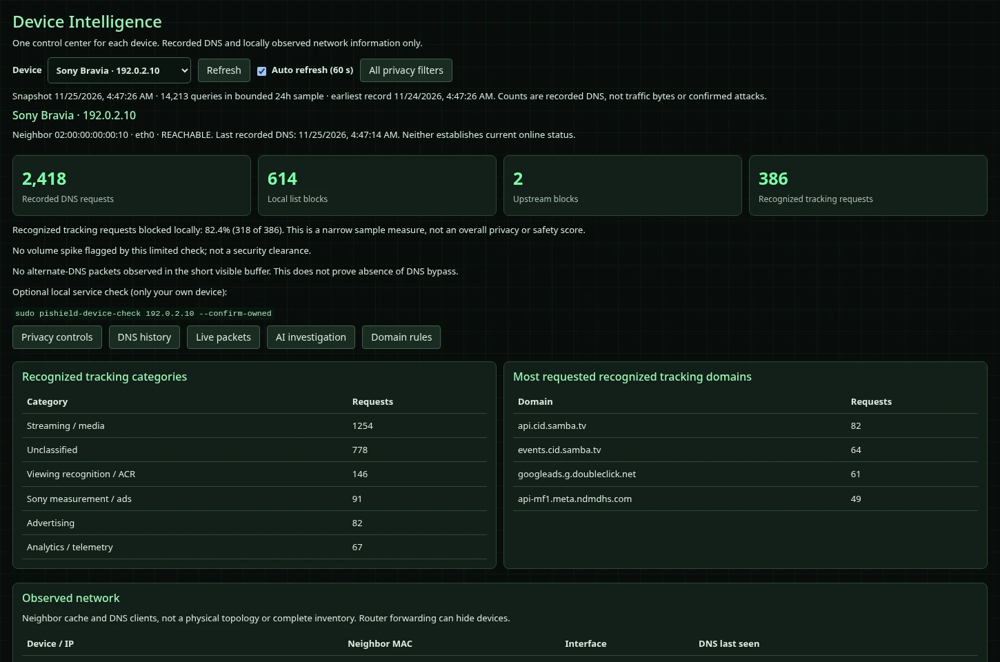
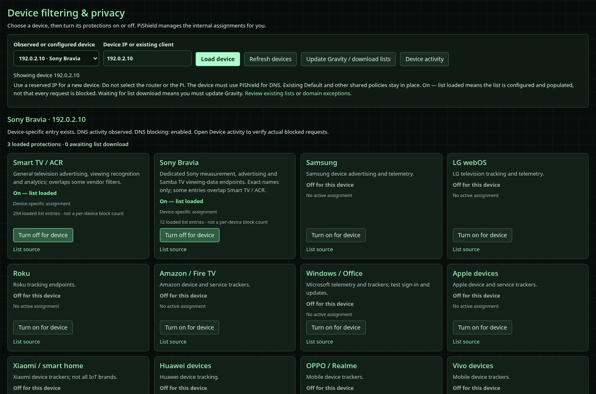
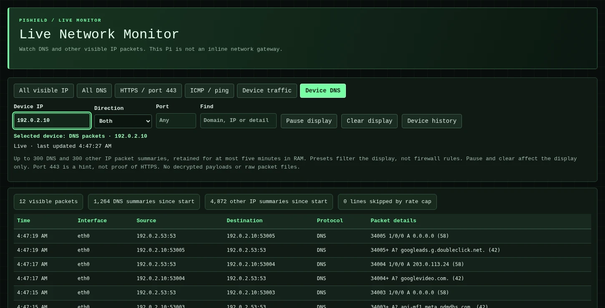

# PiShield 2.1

**What did your smart TV look up while you were watching it?**

Put a Raspberry Pi on DNS duty and find out. PiShield turns Pi-hole into a home network defense console. See the domains your devices request, block known phishing and tracking destinations, and investigate suspicious activity with a local AI model. Manage it from your laptop or phone.

**[Install PiShield 2.1](#install-pishield-21)** · [Upgrade your Pi](#upgrade-your-pi) · [See what shipped in 2.0](CHANGELOG.md)


## New in 2.0 · Device Intelligence

Say your Sony Bravia keeps requesting a domain you don’t recognize. Open **Network → Device Intelligence** and select the TV. You can see its recent DNS activity, which destinations PiShield recognizes as trackers, and how often local filters denied those requests.

From that same view, open the TV’s privacy controls, enable the Sony Bravia filter, and download the list with **Update Gravity**. The next time the TV requests that domain, check its DNS history to see the result. Your laptop and phone can keep their own policies.

Device Intelligence also highlights unusual jumps in query volume when enough history exists. If your router forwards every lookup under one address, the dashboard may only be able to identify the router. [Explore Device Intelligence](docs/DEVICE-INTELLIGENCE.md)



## Choose what gets through

| On your network | What you can do with PiShield |
| --- | --- |
| Phishing and malware domains | Start in **Observation**, switch to **Active defense** to enable managed threat feeds, or choose **Aggressive defense** for broader coverage. Review matches and undo rule changes. |
| Smart TVs and streaming boxes | Choose filters for Sony Bravia, Samba TV viewing-data endpoints, Roku, Fire TV, Samsung, or LG webOS. See which lists have loaded. |
| Phones and computers | Apply vendor telemetry, advertising, or analytics filters by device. Add an exact-domain exception when an app needs access. |
| A device acting strangely | Jump from its DNS history to the live monitor. Filter visible packet metadata by device, DNS, or port. The Pi keeps a rolling five-minute buffer in memory. |

DNS controls cover devices that use the Pi as their resolver. Packet visibility depends on where the Pi sits on your network. [Device filters](docs/DEVICE-FILTERS.md) · [Privacy coverage](docs/PRIVACY-COVERAGE.md) · [Live monitor](docs/LIVE-PRESETS.md)





## Investigate AI-assisted attacks with local evidence

A burst of failed SSH logins on the Pi, a lookup on a threat feed, or a run of unusually long DNS names gives you somewhere to start. Open the event, check the timing, and review the surrounding activity. These signals can surface automated activity, though they can’t establish who ran it or whether AI was involved.

**Put your own model on the case.** Connect Ollama over an encrypted SSH tunnel and ask Sentinel to review DNS activity on demand or every 15 minutes. Inspect the report and decide whether a domain deserves a temporary block. DNS filtering keeps running when the model computer is asleep. [Connect a local model](docs/LOCAL-AI.md)

## AI Chat and Tool Workshop

Chat with your local model on a dedicated page. Choose read-only diagnostic sources and create reusable tools in the Workshop. Ask the model to redesign the dashboard using approved theme settings, preview the changes and save them. Request fixed maintenance operations for explicit owner approval over SSH. Python drafts are review-only; arbitrary generated code is not executed. [AI Chat and Workshop](docs/AI-WORKSHOP.md)

## Get the alert on your phone

Set up private **ntfy** notifications for repeated SSH failures, possible DNS tunneling, or a managed threat-feed match. Alerts carry categories and counts so raw domains and device addresses stay off your lock screen. A morning report summarizes the day’s recorded activity. [Set up phone alerts](docs/PHONE-ALERTS.md) · [Open the dashboard away from home](docs/REMOTE-ACCESS.md)

The Pi watches its own health, too. **Host security** tracks file changes, listening services, power, and storage. Enable SSH rate limiting or try the Pi’s host firewall with a three-minute automatic rollback. [Host firewall](docs/HOST-SECURITY.md) · [SSH protection and updates](docs/PROACTIVE-DEFENSE.md)

## Install PiShield 2.0

Use a Raspberry Pi with **64-bit Raspberry Pi OS Lite**, a fixed LAN address, and internet access. Back up the Pi first. The installer adds services and updates the Pi-hole v6 web interface.

```bash
sudo apt update
sudo apt install -y git curl
git clone https://github.com/zeginbarrett/PiShield.git
cd PiShield
```

Review `install.sh`, then run it on the Pi.

```bash
sudo bash install.sh
```

1. Sign in at `http://YOUR-PI-IP/admin/`.
2. Point one device’s DNS at the Pi, visit a website, and look for the request in **Query Log**.
3. Open **Device Intelligence** to explore that client. When you’re ready to cover more devices, configure the DNS server your router advertises.

### Upgrade your Pi

From your existing PiShield repository directory, run the installer to apply the upgrade, then refresh the dashboard.

```bash
git pull --ff-only
sudo bash install.sh
```

Developed on Raspberry Pi 4 with Raspberry Pi OS Lite (Debian 13). The full fresh-install sequence still needs verification on a separate physical Pi.

[Device privacy monitor](docs/DEVICE-PRIVACY.md) · [Changelog](CHANGELOG.md) · [Credits and compatibility](NOTICE.md) · [EUPL-1.2 license](LICENSE)
