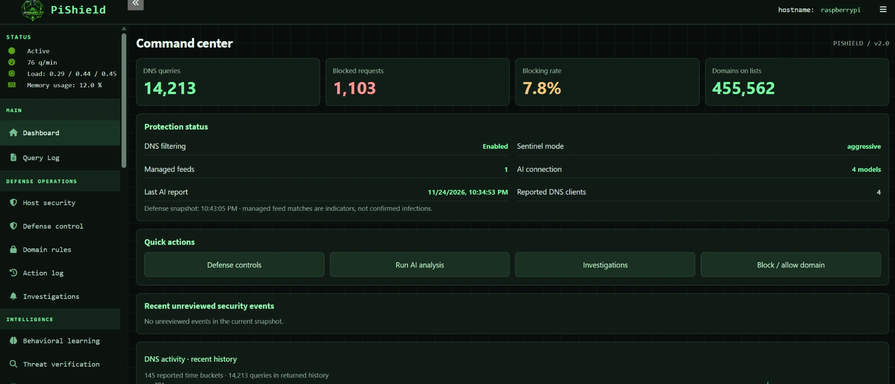

# PiShield

Turn a Raspberry Pi into the DNS defense console for your home network. Block lookups for known phishing and malware domains, investigate suspicious activity, and control which domains your devices can reach through the Pi. Manage it from a desktop or phone.

[Network controls](#network-controls) · [AI-assisted attacks](#investigating-ai-assisted-attacks) · [Phone alerts](#phone-alerts) · [Install](#install)



## Network controls

| What you want to do | Where to start |
| --- | --- |
| See what devices are requesting | Review DNS history and blocking statistics. If your router forwards every request under its own address, individual clients may be hidden. |
| Block unwanted domains | New installs start in **Observation**. Open **Defense control** and select **Active defense** to enable additional threat feeds. **Aggressive defense** is also available. |
| Make an exception or try a temporary block | Add an allow or block rule for a domain, set a temporary rule, or undo a change. |
| Recognize devices on your LAN | Assign trust labels to observed devices and review new neighbors. Labels help identify devices. Your router controls whether they can join the network. |

DNS rules apply to devices that use the Pi for DNS. The optional host firewall controls incoming connections to the Pi itself.

## Privacy & data protection

Open **Filtering → Privacy & data protection** for 14 optional filters, including smart TV viewing-data collection (ACR), Sony Bravia, Samsung, LG, Roku, Fire TV, Windows, Apple, mobile-device trackers, TikTok fingerprinting, general ads and analytics, and known DNS/VPN bypass domains. Choose a scope, assign existing client entries, and update Gravity to download the lists. Filters are off until enabled; existing subscriptions are preserved. Counters show exact-domain matches to recorded gravity-blocked queries, not proof of which list caused a block.

[Privacy controls and list sources](docs/PRIVACY.md)

## Investigating AI-assisted attacks

An automated tool and a human can leave the same traces. PiShield helps you investigate behavior either can produce. DNS and SSH records alone cannot establish whether someone used AI.

| Signal | What to check |
| --- | --- |
| Repeated failed SSH logins on the Pi | Check whether the failures coincide with your own login attempts. Optional Fail2ban protection can temporarily ban a source after repeated failures. |
| A lookup matches a managed threat feed | Review the domain, time, client if visible, and DNS result. A lookup alone cannot tell you whether a connection succeeded. |
| A burst of failed lookups or unusually long DNS names | Review nearby queries from the same client. These patterns can flag possible DNS tunneling and can also come from ordinary software. |

**Local AI review.** Connect Ollama on a trusted computer through an encrypted SSH tunnel. Run **AI analysis** on demand or use the 15-minute Sentinel schedule to review DNS activity. You decide whether to apply a recommended block. The Pi keeps enforcing configured DNS rules while the model computer is offline. [Local AI setup](docs/LOCAL-AI.md)

<details>
<summary>View the Sentinel dashboard from an earlier build</summary>


</details>

## Protect the Pi

Open **Host security** for five-minute checks covering SSH failures, listening services, tracked file changes, power, storage, and observed network changes. Use the 24-hour summary to see when an issue started. The optional firewall has a three-minute trial that rolls back unless you confirm it. SSH rate limiting and automatic Debian security updates can be enabled separately.

[Host checks and firewall setup](docs/HOST-SECURITY.md) · [SSH protection, updates, and system monitoring](docs/PROACTIVE-DEFENSE.md)

## Phone alerts

Configure a private ntfy topic to receive severity-ranked alerts for events such as repeated SSH failures, possible DNS tunneling, and threat-feed matches. The morning report summarizes DNS activity, recorded defense actions, and Pi health at or after **8:00 a.m. Pi local time**. Notifications carry categories and counts. Open the dashboard for investigation details.

[Set up and test phone alerts](docs/PHONE-ALERTS.md) · [Reach the dashboard over a private VPN](docs/REMOTE-ACCESS.md)

## Install

Use a Raspberry Pi running **64-bit Raspberry Pi OS Lite** with internet access and a fixed LAN address. Back up the Pi first. Enable SSH if you plan to install remotely.

```bash
sudo apt update
sudo apt install -y git curl
git clone https://github.com/zeginbarrett/PiShield.git
cd PiShield
```

Review `install.sh`, then run it on the Pi.

```bash
sudo bash install.sh
```

1. Open `http://YOUR-PI-IP/admin/` on your LAN and sign in with the admin password.
2. Set one device to use the Pi for DNS. Visit a site and check that the lookup appears in DNS history.
3. To extend coverage, set the DNS server your router provides to clients to the Pi’s LAN address. Choose your defense mode in the dashboard.

### Update an existing installation

From the PiShield repository directory, run the following commands. The installer preserves existing DNS and firewall settings.

```bash
git pull --ff-only
sudo bash install.sh
```

**Release 1.3** was developed on a Raspberry Pi 4 running 64-bit Raspberry Pi OS Lite (Debian 13). The combined fresh-install sequence still needs verification on a separate physical Pi.

[Changelog](CHANGELOG.md) · [Credits and compatibility](NOTICE.md) · [EUPL-1.2 license](LICENSE)
