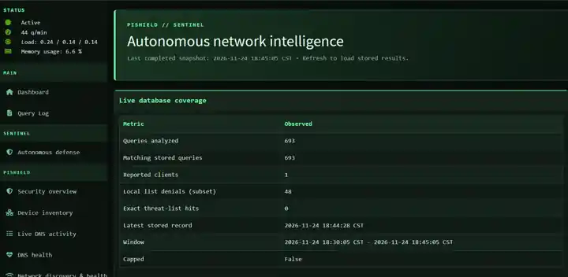

# PiShield v1.1

PiShield is a network security and ad-blocking tool for the Raspberry Pi. It runs on your home network and gives you one place to see DNS activity, block unwanted websites, manage security rules, and keep an eye on connected devices.

You can use it from your computer or phone. It also works with local models through Ollama if you want help reviewing suspicious network activity. You don't need a cloud AI account, and the basic protection keeps working when your computer is turned off.

## Features

- Block ads, trackers, and domains on maintained malware and phishing lists.
- View DNS requests, blocking statistics, and network activity.
- Discover devices and assign trust labels.
- Choose between observation, active defense, and aggressive defense.
- Block or allow individual domains, set temporary rules, and undo changes.
- Review security events, past reports, and unusual DNS activity.
- Run optional local analysis manually or every 15 minutes.
- Manage your network from a desktop or phone.

## Host security

Version 1.1 checks the Pi for failed SSH logins, unusual DNS requests, changed system files, listening services and pending package updates. An optional host firewall blocks unwanted incoming connections, with a three-minute trial that rolls back automatically unless confirmed. Existing network filtering still works without the local model.

[Host security and firewall setup](docs/HOST-SECURITY.md)

## Screenshots




Screenshots are from earlier development builds.

## Install

You'll need a Raspberry Pi running 64-bit Raspberry Pi OS Lite, an internet connection, and a fixed local IP address. Enable SSH when preparing your Pi if you plan to install remotely.

Run these commands on your Pi:

```bash
sudo apt update
sudo apt install -y git curl
git clone https://github.com/zeginbarrett/PiShield.git
cd PiShield
sudo bash install.sh
```

Review the installer before running it as root. Follow the setup prompts, then open `http://YOUR-PI-IP/admin/` in your browser and sign in with the admin password.

Set your router or individual devices to use your Pi as their DNS server. Test DNS resolution before switching the entire network. In **Defense control**, select Active defense if you want to enable the additional threat feeds.

## Connect a local model

Ollama can run on another computer on your network. PiShield connects to it through an encrypted SSH tunnel, so there's no need to expose Ollama publicly. Choose your installed model in **AI settings**.

[Local model setup instructions](docs/LOCAL-AI.md)

## Access from your phone

Open the dashboard while connected to your home Wi-Fi. To access it away from home, use a private VPN such as Tailscale.

[Remote access instructions](docs/REMOTE-ACCESS.md)

## Update from 1.0

From the PiShield directory, run `git pull --ff-only` and `sudo bash pishield-v110.sh`. The firewall is off by default; existing rules and DNS settings are preserved.

## Project status

Current version: **1.1**. Developed on a Raspberry Pi 4 running 64-bit Raspberry Pi OS Lite (Debian 13). The combined fresh-install sequence has not yet been tested on a separate physical Pi. Back up your existing system before installing. See [compatibility and attribution](NOTICE.md) and the [changelog](CHANGELOG.md).

PiShield filters DNS, not all network traffic. Device trust labels do not disconnect devices, and model recommendations require review before blocking. Keep the dashboard password enabled and use a private connection for remote access.

[License (EUPL-1.2)](LICENSE) · [Credits and compatibility](NOTICE.md)
